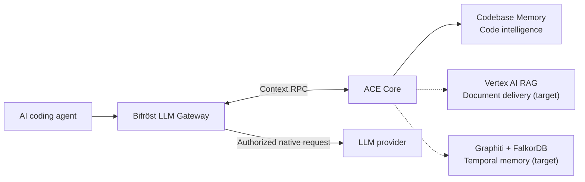

# Adaptive Context Engine (ACE)

**Give AI coding agents the right context, not more context.**

ACE is open-source, agent-agnostic context engineering infrastructure for AI coding agents. Its hybrid retrieval architecture combines structural code intelligence, project documentation and persistent project memory, with context delivered at the LLM gateway rather than through a separate integration for every agent. The current native Responses projection delivers verified code context; document and memory delivery are separate integration stages.

Coding agents are good at reasoning about code, but finding the right code can be expensive. They repeatedly search files, rediscover dependencies, read documentation and reconstruct decisions from previous sessions. ACE is designed to turn that exploration into focused, source-verified evidence, leaving more of the context window for solving the actual task.

- **Understand unfamiliar code faster:** find relevant functions, callers, dependencies and implementation paths instead of reading files one by one.
- **Spend fewer tokens on discovery:** deliver compact, relevant evidence and preserve access to complete authorized originals.
- **Ground changes in project requirements:** the documentation layer is designed to retrieve specifications, architecture decisions and technical guides alongside code.
- **Carry knowledge across tasks:** the temporal-memory design lets agents recover earlier decisions, rejected approaches and the reasons behind them.
- **Keep your preferred agent:** context delivery happens through the LLM gateway; the agent retains its own tools, reasoning and workflow.

[How it works](#how-it-works) · [Agent compatibility](#agent-compatibility) · [Three layers of context](#three-layers-of-context) · [Token efficiency](#token-efficiency) · [Get started](#local-development)

## How it works



The gateway receives the agent's request. ACE identifies relevant evidence, checks source identity and access policy, and prepares context for the same model request. Bifröst delivers that request only after an independent physical-send authorization. The model can continue using its ordinary tools to investigate, edit files and run tests.

This is **not another coding agent**, an agent scheduler, or a tool server that the model must remember to call. Retrieval is controlled by the application at the gateway boundary. The core is independent of the agent's UI, planning strategy and tool loop.

## Agent compatibility

ACE is designed around **one context engine, many agent harnesses**. A gateway integration can serve multiple clients that use the same supported wire protocol; adding a client should not require another RAG engine, code index or memory store.

| Agent / harness | Integration direction |
| --- | --- |
| Hermes | Current reference integration: native ChatGPT/Codex Responses with Hermes-owned subscription OAuth. |
| OpenAI Codex | Natural candidate for a compatible native Responses endpoint; separate client verification required. |
| Aider | Candidate via a configurable LLM endpoint and a supported request protocol. |
| OpenCode | Candidate via custom provider configuration and a supported request protocol. |
| Claude Code | Candidate via an Anthropic-compatible gateway endpoint; native Messages context delivery would require additional support. |
| Google Antigravity | Potential integration if the client exposes a supported gateway route; endpoint configurability and protocol compatibility must be established. |

Bifröst supports a wider provider ecosystem than the current ACE integration. ACE's active generation contract is **provider-native Responses only**. Additional native protocols, such as Anthropic Messages, Chat Completions or Gemini, require approved architecture changes and protocol-specific lossless delivery and security tests. No translation or fallback is implied, and the list is a compatibility direction, not a claim of completed end-to-end support.

## Three layers of context

### 1. Code intelligence — understand relationships, not just text

[Codebase Memory](https://github.com/DeusData/codebase-memory-mcp) builds a persistent local knowledge graph from source code using Tree-sitter. Its structural, semantic and lexical discovery can identify relevant symbols, follow call chains, explore dependencies and help assess the impact of changes.

**Example:** ask an agent to change the connection retry policy without affecting payment retries. Instead of guessing filenames or reading every networking module, graph discovery can identify the retry implementation, its callers and adjacent dependencies. ACE can deliver selected source-verified snippets to the model, while the agent can still inspect complete files and run tests.

ACE uses CBM as its sole code retrieval engine, including native semantic search and SQLite FTS5/BM25. It checks the selected evidence against the current working tree, verifies exact UTF-8 source ranges and SHA-256 digests, and rejects stale or unauthorized evidence. Graph relationships are discovery hints, not substitutes for the actual source.

### 2. Project documentation — know what the software is supposed to do

[Google Cloud Vertex AI RAG Engine](https://docs.cloud.google.com/gemini-enterprise-agent-platform/build/rag-engine/rag-overview) provides managed document ingestion, chunking, indexing and relevance-based retrieval. An authorized corpus can contain product requirements, architecture documents, API specifications, operational runbooks and internal engineering guides.

**Example:** an agent implementing a new payment operation needs to understand not only existing code, but also the documented idempotency contract, retry limits and security requirements. In the target combined delivery path, relevant passages from the configured corpus accompany code evidence, so the model can reason about both implementation and intended behavior.

ACE has a Vertex retrieval adapter for an explicitly configured corpus; document ingestion and corpus management use [Vertex's supported facilities](https://docs.cloud.google.com/gemini-enterprise-agent-platform/build/rag-engine/use-data-ingestion). Cloud document retrieval is opt-in and scoped to authorized project documents. It does not authorize uploading private source code, credentials or conversations. **Current scope:** the native Responses projection requests code only and rejects non-code evidence. Combining Vertex passages with code in the outbound request requires its own integration and acceptance.

### 3. Persistent project memory — remember why decisions were made

[Graphiti](https://github.com/getzep/graphiti) is a temporal knowledge-graph engine that represents evolving facts and their relationships over time. It can combine information from past conversations and structured records, retain historical relationships and distinguish newer facts from superseded ones. The [Zep research preprint](https://arxiv.org/abs/2501.13956v1) describes the underlying temporal graph architecture; its evaluation is of Zep, not ACE or an independently deployed Graphiti instance. ACE's target uses Graphiti with FalkorDB and a local-first memory policy, backed by immutable original records.

**Example:** a team once evaluated automatic payment retries but rejected them because the provider lacked idempotency guarantees. Months later, an agent proposes the same approach while planning another task. With persistent temporal recall, the agent could respond:

> We already considered this approach. It was rejected because retrying an ambiguous payment response could create duplicate charges. The previous decision requires an idempotency guarantee before revisiting it.

If the provider subsequently adds that guarantee, the memory should preserve the original rationale while allowing the newer evidence to change the decision. Historical records are not automatically current requirements.

The same design can retain architectural decisions and alternatives, lessons from failed implementations, previous investigations and evolving project constraints across tasks, sessions and compatible agents.

**Implementation scope:** ACE has an independent immutable archive; gateway-native Graphiti retrieval is a planned integration, not an enabled runtime feature. See the [readiness matrix](docs/operations/ace-configuration-and-readiness-matrix.md).

## Token efficiency

**Less exploration. More room for reasoning.**

Codebase intelligence changes the economics of agentic development: a dependency query can return a focused set of symbols and relationships instead of flooding the model with entire files. Relevant documentation and historical decisions can also reduce repeated investigation when those sources are available.

Published CBM results illustrate the opportunity:

| Result | Workload and source |
| --- | --- |
| **99.2% fewer tokens (~121:1)** | Five structural queries: approximately 3,400 vs 412,000 tokens for CBM versus file-by-file grep exploration, as reported in the [historical upstream README, line 311](https://github.com/DeusData/codebase-memory-mcp/blob/4ff6feeab639c4668da0f491930326ed5ec63093/README.md#L311). The original inputs and raw artifacts are required for exact reproduction. |
| **10× fewer tokens per question; 2.1× fewer tool calls** | [Codebase-Memory preprint, §4.1, Table 6](https://arxiv.org/html/2603.27277v1#S4.SS1): about 1,000 vs 10,000 tokens and 2.3 vs 4.8 calls per question, using Claude Opus 4.6 across 31 repositories. Author-graded mean quality scores: 0.83 vs 0.92. See [§5.4](https://arxiv.org/html/2603.27277v1#S5.SS4) for limitations. |
| **~22× fewer retrieval-output tokens** | [Independent analysis by Emre Cavunt, One question, three bills](https://emrecavunt.com/blog/codebase-memory-mcp%2Dtoken-economy#one-question-three-bills): 3,004 vs 67,428 tokens on Google ADK Python, using CBM v0.9.0 and a disciplined grep/file-reading baseline. Counts use the cl100k_base tokenizer on command output, not live model usage; no agent ran in the loop. |

These are component-level exploration results, not ACE-wide task savings. The size of the benefit depends on the task, baseline, context selection and model. ACE combines structural discovery with exact source evidence rather than assuming a graph alone answers every question.

ACE targets a **5× reduction in total model tokens per accepted coding task**, with correctness as the first constraint. The [evaluation protocol](https://github.com/chris-madsen/Hybrid-RAG/issues/171) compares matched agent runs, includes retries and failed attempts, and measures actual provider usage and independently verified outcomes.

## Architecture

The [Architecture Description](docs/architecture/README.md) contains the ISO/IEC/IEEE 42010:2022-aligned views, decisions and traceability. The [current runtime architecture](docs/operations/current-architecture.md) distinguishes implemented components from target capabilities.

ACE is neither an agent scheduler nor a second model proxy. Hermes owns its subscription OAuth; Bifröst forwards the bearer on its existing native subscription route. ACE never authenticates to ChatGPT on the agent's behalf, chooses billing credentials, generates model responses, or exposes retrieval tools for discretionary model invocation. No API-key or legacy Chat/Completions fallback is permitted for the subscription path.

The ACE internal interface is TypeSpec-defined `ace.context.v3` HTTP/JSON RPC, with generated TypeScript, OpenAPI, JSON Schema and SDK artifacts. Its four operations are:

| Method | Internal path (prefix: `/internal/ace-context/v3`) |
| --- | --- |
| GET | `/health` |
| GET | `/capabilities` |
| POST | `/project` |
| POST | `/authorize-attempt` |

The Go plugin applies context to the **same** native Responses request. Projection preserves the original input items and opaque fields, and adds verified evidence rather than replacing the agent's history. `PREPARED` is not permission to send: each physical attempt requires a fresh, single-use authorization bound to the protected final request, route, model and source/data policy. Unknown or denied attempts fail closed.

See [ADR-021: single Bifröst Gateway](docs/references/ADR-021-bifrost-single-gateway-ace-context-service.md), [ADR-020: native Responses](docs/references/ADR-020-native-responses-only.md), [current architecture](docs/operations/current-architecture.md) and the [Go connector](integrations/bifrost/ace-connector/README.md).

### Source fidelity and privacy

Current verified source is authoritative for implementation facts; documented requirements and historical decisions provide different evidence, not replacements for current source bytes. ACE verifies workspace membership, original bytes and source ranges; required-source coverage and uncertainty determine completeness. Large authorized originals remain accessible without silently truncating them. Provider outages and denied requests are explicit failures, not successful empty results.

Code indexing is local by default. External retrieval and model-bound transmission require separate data-class and destination authorization. The gateway checks each protected physical attempt, including retries, rather than treating a prepared projection as permission to send.

## Project status

ACE is under active development. Native code retrieval, the internal context RPC, source verification and gateway policy contracts are implemented. The current reference path is Hermes through Bifröst; live agent acceptance, independent retrieval and token-economics evaluation, and gateway-native document and temporal-memory delivery have separate acceptance gates. See the [readiness matrix](docs/operations/ace-configuration-and-readiness-matrix.md), [OpenSpec gateway acceptance](openspec/changes/013-gateway-g11-production-acceptance/tasks.md) and [reliability acceptance](openspec/changes/014-ace-audit-reliability-remediation/tasks.md) for the authoritative status instead of a dated changelog here.

## Local development

Node.js/TypeScript and Effect implement the core modular monolith using functional DDD; Go is the Bifröst integration boundary. Python remains available for independent memory, HTTP and evaluation tooling. Docker provides local deployment infrastructure; full-unified k3s deployment remains a separate acceptance scope.

```bash
npm ci
npm run check
npm run lint
npm run test:affected
npm run verify:pr
# Full deterministic verification (scheduled/manual scope)
npm run verify:full
# Read-only provider/environment probe
npm run probe:providers
npm install --global codebase-memory-mcp@0.12.1
codebase-memory-mcp --version
```

Use the [configuration matrix](docs/operations/ace-configuration-and-readiness-matrix.md) for the native local path. No external embedding worker, Qdrant service or LSP is needed for native code-only projection.

### Local context RPC and hybrid retrieval

Start the local context engine with the configured retrieval providers:

```bash
export ACE_WORKSPACE_ROOT=/absolute/path/to/repo
export ACE_ALLOWED_ROOTS=/absolute/path/to
# Optional ACE_CBM_COMMAND: absolute path to the pinned native executable.
# Supply ACE_CONTEXT_RPC_SHARED_SECRET securely, outside version control.
npm run context:rpc
```

The native runtime is the default and only code retrieval path. It requires an ACE-local authorized workspace, rejects remote helper and legacy provider enablement, and never falls back to another code engine. By default the internal RPC listens on loopback port 8765. Configure the colocated Bifröst plugin with `ACE_CONTEXT_RPC_URL=http://127.0.0.1:8765/internal/ace-context/v3/project`, matching `ACE_CONTEXT_RPC_TOKEN` and the registered workspace/single-workspace tenancy configuration. A missing secret leaves projection unavailable; incorrect bearer credentials are rejected. Hermes must target Bifröst's `/chatgpt_passthrough/backend-api/codex` SDK base prefix, never the ACE RPC or a direct provider endpoint.

Use the [subscription OAuth runbook](docs/operations/gateway-subscription-oauth.md) for exact pinned build, route, workspace and data-policy configuration. The v3 endpoint, generated types and plugin must be deployed atomically; there is no compatibility alias or silent provider fallback. Without real required retrieval providers, the service reports not-ready rather than simulating production search.

Vertex requires both `ACE_ENABLE_VERTEX=true` and `ACE_CLOUD_DOCS_OPT_IN=true`, with `ACE_VERTEX_PROJECT`, `ACE_VERTEX_CORPUS_ID` and the applicable location (default `europe-west4`). Permission covers authorized `project_document` only. `ACE_ENABLE_GRAPHITI=true` intentionally fails startup until an active context RPC memory provider exists.

### Source-verified Docker image

```bash
make ace-image ACE_NODE_IMAGE='node:22-bookworm-slim@sha256:<verified-64-hex>' ACE_IMAGE_TAG=ace:local
```

Build from a clean Git checkout. The Make target compiles ACE before building the image; `dist/runtime-provenance.json` binds the source manifest and runtime executable. The Docker context excludes `.git`; stale or missing provenance fails packaging. This establishes build identity, not live provider delivery.

## Verification and release

| Scope | Entry point | What it establishes |
| --- | --- | --- |
| Deterministic PR | `npm run verify:pr` | Typecheck, affected tests, lint, architecture and SDLC checks |
| Full local | `npm run verify:full` | Full deterministic suite, build and property tests; not live E2E |
| Bifröst boundary | `npm run check:bifrost-context` | Single model gateway and internal context RPC architecture |
| Native CBM | [Pinned real-CBM CI](.github/workflows/ace-codebase-memory.yml) | Real structural/graph provider integration |
| Local code retrieval | `ACE_REAL_PROJECTION_NATIVE_CBM=true npm run test:real-projection`; see native CI for fault scenarios | Real local retrieval and source/failure behavior, not model egress |
| Archive and LSP | `npm run test:memory-process`, `npm run test:real-same-name`, `npm run test:real-non-ts-lsp` | Archive/process and symbol verification within their respective scopes |
| Container | `npm run test:ace-container-runtime -- --image <pinned>@sha256:<digest> --bundle <dir>` | Compiled context service liveness |
| Real subscription / Hermes / Harbor | [Acceptance runbook](docs/operations/2026-11-21-hermes-e2e-repair-runbook.md) | Separate exact-route, physical provider wire, SSE, multi-turn tools and independently scored tasks |
| Release | `npm run release:preflight -- ...` | Evidence-gated release evaluation, not an override for missing proofs |

Evaluate retrieval independently with upstream Agent Retrieval Bench, ContextBench and CodeGraph Bench; evaluate end-to-end agent behavior and economics with Harbor using matched frozen tasks, model/effort, tools and source budgets. Count retries, failed attempts and total usage; unknown telemetry is not zero. Require independent task correctness before drawing accepted-task token conclusions. Use the [testing strategy](docs/operations/testing-strategy.md) and [current Harbor acceptance specification](openspec/changes/013-gateway-g11-production-acceptance/phases/C08.md).

See the [acceptance runbook](docs/operations/2026-11-21-hermes-e2e-repair-runbook.md) for real task and provider verification. Local preparation and deterministic checks are distinct from live acceptance.

## AI-assisted SDLC and contribution

Read [AGENTS.md](AGENTS.md) before editing. The repository uses risk-based T0/T1/T2 routing, OpenSpec behavioral contracts, functional DDD/Event Storming, TypeSpec code generation, Meyer Design by Contract and explicit evidence gates. The harness-neutral R/S/A/P/X/I/V process starts at the requested stage and reuses verified prior artifacts, rather than restarting research on every session. New unresolved material T2 architecture choices require owner G02 review; code/CI evidence cannot substitute for that decision.

Use the [ACE SDLC skill](.agents/skills/ace-sdlc/SKILL.md) and the [local agent trial](docs/operations/local-agent-sdlc-trial.md):

```bash
npm run test:sdlc-preflight
npm run sdlc:preflight -- --tier T0 --stage research --json
```

For implementation, supply the explicit task ID, existing plan and applicable G02 evidence. Follow the [operational SDLC](docs/operations/ai-assisted-sdlc.md) and [stage entry/resume](docs/operations/implementation-entry-resume.md). Publish reviewable PRs targeting main and report actual check/evidence states; merge remains the owner's decision. Do not turn deterministic checks into production certification.

## License

ACE is available under the [Apache License 2.0](LICENSE).
