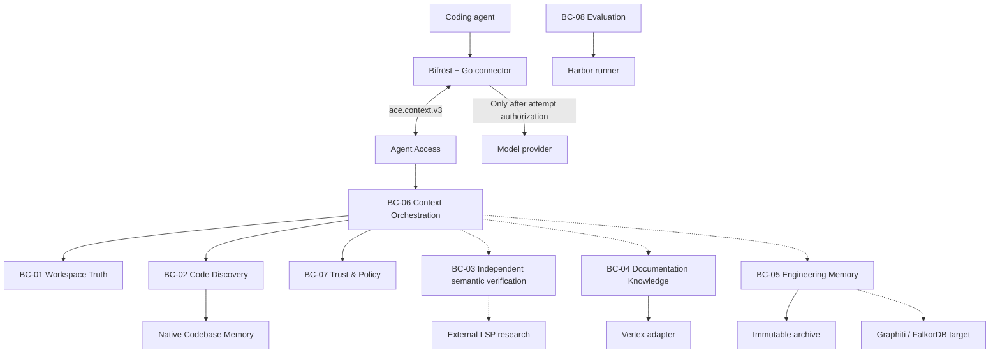

# ACE — Strategic DDD: subdomains, bounded contexts and context map

> **Design model, not an implementation inventory.** This document reconciles the original logical design with the native CBM cutover and the single Bifröst boundary. Identifiers, proposed events and logical consistency boundaries do not imply that corresponding classes, tables or public operations exist. The [original record](https://github.com/chris-madsen/Hybrid-RAG/blob/d19b8ac04ce3861ee0b477fd5253c684edb5136f/docs/architecture/01-strategic-ddd.md) remains in Git history. Current implementation and acceptance are described in [current runtime architecture](../operations/current-architecture.md), the accepted ADRs and applicable OpenSpec.

## 1. Domain vision and system objectives

ACE is an agent-neutral context engine. Its responsibility is to identify relevant evidence for a coding task, verify it against authorized sources and prepare an additive context projection for the same native Responses request. It does not write code, schedule agents, manage their private reasoning or history, authenticate to the model provider, or dispatch a second model request.

The supported integration boundary is Bifröst and its thin Go connector, which invokes the authenticated local TypeScript/Effect context RPC. Hermes is the reference client; other compatible harnesses require their own protocol and route verification. External orchestration is outside ACE.

The measurable objective is at least a fivefold reduction in total model tokens per accepted task against a strong native baseline, without degrading independently assessed task quality. This is a hypothesis, not a result. Measure latency, external costs, failure rate and retrieval quality separately; include failed attempts and report configuration and limitations. See [evaluation issue #171](https://github.com/chris-madsen/Hybrid-RAG/issues/171).

## 2. Ubiquitous language

| Term | Meaning and boundary |
|---|---|
| Workspace | Registered, authorized local repository or working tree; not synonymous with a Git commit. |
| WorkingTreeVersion | Identity of observed source state, including uncommitted changes; not an atomic snapshot of the entire filesystem. |
| SourceEvidence | A reference to an identified source, digest, range and evidence method; not proof of program correctness. |
| Candidate | Ranked discovery result; relevance, freshness, scope and correctness still require verification. |
| VerifiedCurrent | Exact source identity checked at the observation boundary; not a guarantee against later concurrent edits. |
| SemanticFact | Definition, reference or type established within a specific language-analysis provider's capabilities; not a graph hint relabeled as an LSP fact. |
| UnknownDynamicEdge | A possible relationship hidden by dynamic dispatch, reflection or runtime registration; missing static edges do not prove absence. |
| ContextRequest | Internal authorized request for evidence, derived from a request-bound gateway projection. |
| RetrievalPlan | Required and optional source obligations and permitted retrieval operations; not a guarantee that every source is available. |
| ContextBundle | Internal evidence, excerpts, provenance and completeness information; not a patch or provider response. |
| SessionEpisode | Original imported session fragment with provenance and timestamps; exact capture depends on the supported importer. |
| DecisionRecord | A proposed, accepted, rejected or superseded decision linked to its original evidence; not an automatically accepted summary. |
| BenchmarkRun | One execution of a pinned agent configuration on an identified task/environment. |
| EvaluationSuite | Versioned, frozen task set and scoring rules, including independent holdout where required. |
| PolicyDenied | Prohibited operation; not interchangeable with a provider outage. |
| TechnicalDegradation | A permitted dependency is unavailable; report missing evidence and block when required coverage cannot be established. |

## 3. Subdomains and responsibilities

| Subdomain | Strategic role | Responsibility |
|---|---|---|
| Context Orchestration | Core | Select evidence obligations, assemble relevant verified context, preserve original access and represent uncertainty. |
| Workspace Truth & Freshness | Core/supporting | Establish workspace identity, observe current source and invalidate stale evidence. |
| Temporal Engineering Memory | Core target | Recover prior decisions and rationale with historical provenance; archive is implemented separately from live temporal recall. |
| Code Discovery | Supporting | Delegate structural, semantic, lexical and graph discovery to native CBM. |
| Semantic Code Intelligence | Supporting | Interpret structural evidence and independently verified language-service facts where required; preserve static-analysis limits. |
| Documentation Knowledge | Supporting | Retrieve authorized project documents through the Vertex adapter. |
| Trust & Data Policy | Generic, security-critical | Authorize source access, external destinations and every physical model attempt; fail closed. |
| Agent Access | Interface | Translate native Bifröst requests into local context RPC calls. |
| Experimentation & Evaluation | Supporting assurance | Collect reproducible retrieval/task evidence, grade outcomes and measure actual usage. |

These classifications describe responsibilities, not a commercial offering, process topology or proof of implementation.

## 4. Bounded contexts (BC)

| ID | Logical ownership | Current implementation or target |
|---|---|---|
| BC-01 Workspace Truth | Registered identity, source observations, revision/digest, containment and invalidation. | WorkspaceSync and authorized source verification. |
| BC-02 Code Discovery | Candidate selection and provider readiness, not source truth. | CBM owns its native index, AST, graph, semantic and BM25 discovery; ACE does not maintain a second vector index. |
| BC-03 Semantic Intelligence | Evidence method, exact spans, symbol identity and limits of static analysis. | CBM structural hints plus ACE byte verification. Independent LSP adapters/contracts remain; native code-only RPC does not request LSP evidence (#364). |
| BC-04 Documentation Knowledge | Corpus identity, permitted document evidence and citations. | Vertex adapter exists; combined document delivery through native Responses is not established by the current code-only projection. |
| BC-05 Engineering Memory | Immutable originals, decision provenance, temporal status and deletion. | Archive and lifecycle mechanisms exist; Graphiti/FalkorDB is the selected temporal projection target, not a configured gateway runtime. |
| BC-06 Context Orchestration | Required coverage, relevance, deduplication, verification and request-local projection. | TypeScript/Effect application; signed PREPARED receipt or explicit BLOCK. |
| BC-07 Trust & Policy | Authorization, source classification, protected attempt binding, secret-safe auditing. | Policy and per-attempt decision service; Bifröst enforces the physical-send boundary. |
| BC-08 Evaluation | Frozen tasks, provider/task/attempt attribution, correctness and usage accounting. | Harbor integration and evidence tooling; independent acceptance remains open. |

Agent Access is an anti-corruption layer (ACL), not a ninth core bounded context. The Go connector owns transport adaptation, not retrieval, domain policy or agent planning.

## 5. Context map

Solid relationships describe the current code-only projection; dotted relationships identify independent or target retrieval capabilities, not active delivery.

| Relationship | DDD relationship | Contract |
|---|---|---|
| Workspace Truth → discovery and verification | Published language | Registered identity, observed paths, digests and revision; downstream projections cannot redefine source truth. |
| Code Discovery → Orchestration | Provider ACL/query port | Ranked native candidates and readiness; not verified facts by default. |
| Semantic Intelligence → Orchestration | Customer/supplier through typed ports | Method, symbol/range identity, uncertainty and unavailable status where applicable. |
| Documentation Knowledge → Orchestration | External service ACL | Authorized corpus, source citation, excerpt and limitations. |
| Engineering Memory → Orchestration | Archive/temporal projection boundary | Original episode reference and decision status; derived facts remain secondary. |
| Trust & Policy → external I/O | Mandatory policy contract | Allow/deny with reason; absence of authorization does not permit sending. |
| Orchestration → Agent Access | Versioned published language | Internal context RPC v3, no provider-specific retrieval DTO leakage. |
| Evaluation ↔ Harbor | ACL | Frozen task/run identity, observed outcome and normalized usage. |

Bounded contexts are logical ownership boundaries, not Kubernetes pods. ACE remains a modular monolith; deployment of existing external dependencies is a separate concern.

## 6. External systems and comparison boundaries

CBM is the selected sole code retrieval engine. Vertex is selected for authorized documentation; Graphiti/FalkorDB is selected for the future temporal projection. Harbor is the experiment runner, not the source of correctness. A strong unmodified agent remains the matched baseline. Codex is a historical comparison client; Hermes is the current reference route. Prior research into Serena, Qdrant, separate embedding workers and alternative graph engines is not permission to reintroduce them.

No competitive superiority, production readiness or end-to-end token saving follows from these selections. See [native CBM cutover](../plans/2026-11-25-native-cbm-cutover-and-legacy-retirement.md) and [readiness](../operations/ace-configuration-and-readiness-matrix.md).

## 7. Integration strategy and risks

- Keep provider DTOs and I/O in adapters; implement domain invariants with immutable ADTs and pure functions, orchestrated by Effect.
- Treat indexed snippets, documents and memory as untrusted evidence, never as policy or executable instructions.
- Recheck source identity and required coverage at delivery; never infer exact language-service coordinates or runtime behavior from graph hints.
- Separate project/prepare from per-physical-attempt authorization; no silent provider or protocol fallback.
- Use durable outbox and idempotent retry where required by observed lifecycle needs. Domain events do not mandate an event bus or event sourcing.
- Record safe diagnostics and usage; full observability remains a separate decision under ADR-010.

## 8. Authority and unresolved decisions

Use [PRD](../references/PRD-v1.0.md), [ADR register](../references/ADR-000-decision-register.md), [ADR-019](../references/ADR-019-functional-ddd-typespec-contracts.md), [ADR-020](../references/ADR-020-native-responses-only.md), [ADR-021](../references/ADR-021-bifrost-single-gateway-ace-context-service.md) and [AGENTS.md](../../AGENTS.md). ADR-006 governs exact original access without forced truncation. The selected native-only runtime supersedes old vector-specific designs; preserve their historical rationale in Git.

Open questions include absolute retrieval quality and scale, native daemon/cache and remote-worktree topology (#363), independent external LSP scope (#364), authorized document and temporal delivery, real provider/agent acceptance and matched task economics. Consult [OpenSpec 013](../../openspec/changes/013-gateway-g11-production-acceptance/tasks.md) and [OpenSpec 014](../../openspec/changes/014-ace-audit-reliability-remediation/tasks.md) rather than inferring readiness from a conceptual model.

## Architecture correction: a bounded context is not a runnable provider

A port, event name, value object, mock or adapter on disk does not prove a delivered capability. The required provider must be invoked by the claimed runtime, its evidence verified and the result observed at the applicable boundary. This principle retains the original 2026-10-18 design correction without treating its historical provider choices as current.
