# ACE — Event Storming: events, commands, policies and unresolved questions

> **Design model, not an implementation inventory.** This document reconciles the original logical design with the native CBM cutover and the single Bifröst boundary. Identifiers, proposed events and logical consistency boundaries do not imply that corresponding classes, tables or public operations exist. The [original record](https://github.com/chris-madsen/Hybrid-RAG/blob/d19b8ac04ce3861ee0b477fd5253c684edb5136f/docs/architecture/02-event-storming.md) remains in Git history. Current implementation and acceptance are described in [current runtime architecture](../operations/current-architecture.md), the accepted ADRs and applicable OpenSpec.

**Status:** conceptual Big Picture, Process Level and Design Level model; proposed event and command vocabulary, not a catalog of implemented messages. Event Storming is domain discovery for material T2 changes, not a requirement for event sourcing. Use immutable ADTs, pure transitions, Effect ports and TypeSpec at versioned wire boundaries.

## 1. Event Storming legend

| Marker | Meaning |
|---|---|
| Domain event | A fact that has occurred (past tense). |
| Command | An intention that may be rejected. |
| Policy/process manager | A rule reacting to an event. |
| Aggregate | A logical invariant/consistency boundary. |
| Read model | A projection used for queries. |
| Hot spot | A question requiring design or empirical evidence. |
| Actor | Owner, coding agent, operator or evaluation runner. |

## 2. Big picture — workflow

```mermaid
flowchart LR
  A["Register workspace"] --> B["WorkspaceRegistered"]
  B --> C["SnapshotObserved"]
  C --> D["CodeIndexPublished"]
  D --> E["ContextRequested"]
  E --> F["RetrievalPlanned"]
  F --> G["EvidenceCollected"]
  G --> H["ContextBundleComposed"]
  H --> I["ProjectionPrepared or Blocked"]
  I --> J["AttemptAuthorized or Denied"]
  J --> K["Provider result, if allowed"]
  K --> L["Agent edits/tests"]
  L --> M["WorkspaceChanged"]
  M --> N["IndexInvalidated"]
  N --> D
```

Memory ingestion (separate/target workflow): SessionArchived → KnowledgeExtracted → DecisionAccepted/Rejected/Superseded. Evaluation: BenchmarkRunRequested → EnvironmentPrepared → AgentRunCompleted/Failed → UsageCaptured → QualityGraded → ComparisonPublished. The latter uses isolated task environments, not the real user working tree. These are conceptual milestones, not promises of a persisted event bus.

## 3. Flow A — workspace and native code index

| Actor/trigger | Command | Logical boundary | Proposed event | Policy/read model |
|---|---|---|---|---|
| Operator | RegisterWorkspace | Workspace | WorkspaceRegistered | Validate authorized root and observe workspace. |
| Source observation | ObserveWorkspace | Workspace | SnapshotObserved / WorkspaceChanged | Invalidate affected evidence, reconcile current manifest. |
| Native index lifecycle | StartIndexGeneration | CodeIndex | IndexBuildStarted | Delegate index/AST/graph/semantic/BM25 to CBM. |
| Reconciliation succeeds | PublishIndexGeneration | CodeIndex | CodeIndexPublished | Publish ACE's verified observation only after required checks. CBM owns native index/cache. |
| Provider failure | MarkIndexDegraded | CodeIndex | IndexBuildFailed | Invalidate affected publication, report not ready; no retired vector fallback. |

**Invariant A:** After WorkspaceChanged, stale evidence cannot be presented as VerifiedCurrent. File mutation between discovery, materialization and delivery requires source re-observation and digest verification; unresolved races must fail or be represented explicitly. ACE does not invent a transaction encompassing the filesystem and CBM internals.

## 4. Flow B — a context request and physical attempt

| Actor/trigger | Command | Logical boundary | Proposed event | Policy/read model |
|---|---|---|---|---|
| Bifröst connector | RequestContext | ContextRequest | ContextRequested | Validate request identity, workspace and allowed scope. |
| Policy | AuthorizeContextRoute | AccessDecision | RouteAllowed / RouteDenied | Denied path stops; audit safely. |
| Orchestration | PlanRetrieval | ContextRequest | RetrievalPlanned | Current projection requires code; broader source plans are separate scope. |
| Native provider | CollectEvidence | ContextRequest | EvidenceCollected / SourceUnavailable | Return ranked candidates and typed failure. |
| Workspace verifier | VerifyEvidence | ContextRequest | EvidenceVerified / FreshnessUnknown | Reread exact bytes/digests and ranges; no fabricated LSP facts. |
| Composer | ComposeBundle | ContextRequest | ContextBundleComposed | Relevance, required coverage, deduplication and exact provenance. |
| Context RPC | ProjectModelContext | Projection request | ProjectionPrepared / ProjectionBlocked | Return PREPARED with signed receipt or BLOCK. |
| Bifröst physical boundary | AuthorizeAttempt | Attempt identity | AttemptAuthorized / AttemptDenied | Verify receipt and actual final attempt under current policy; each retry needs a new attempt. |

**Invariant B:** CandidateFound, VerifiedCurrent, PREPARED, attempt authorization and observed provider delivery are distinct facts. The final guard is not a consequence of merely preparing context.

**Invariant C:** ACE does not rewrite generated patches or truncate the agent's original native input. Exact authorized source remains available independently of compact evidence selection.

Hot spots: required-source failure, source races, request deadlines, repeat evidence, token cost and permission changes. Measure the complete workflow; a router model call or speculative extra retrieval is not automatically beneficial.

## 5. Flow C — engineering memory across sessions (target integration)

| Trigger | Command | Logical boundary | Proposed event | Policy/read model |
|---|---|---|---|---|
| Authorized importer | CaptureSession | SessionArchive | SessionCaptured | Preserve and deduplicate exact originals, with approved data scope. |
| Archive | SealEpisode | SessionArchive | SessionArchived | Verify digest, enqueue derived processing. |
| Extraction worker | ExtractKnowledge | MemoryFact | KnowledgeCandidateExtracted | Link claims to original episode/offset. |
| Owner | ApproveDecision | DecisionRecord | DecisionAccepted | Retain approval, validity and provenance. |
| Owner | RejectDecision | DecisionRecord | DecisionRejected | Do not present as current requirement. |
| Approved replacement | SupersedeDecision | DecisionRecord | DecisionSuperseded | Retain old rationale and replacement identity. |
| Authorized deletion | DeleteStoredData | ArchivePrivacyRecord | DeletionRequested / DataErased | Remove access, reconcile derived projection and retention scope. |

**Invariant D:** Graphiti is a derived temporal projection; extraction does not make a claim an accepted decision. Archive integrity is independent of extraction success. Deletion is reference-safe and policy-controlled. Current archive tooling does not establish a gateway-native temporal recall capability; the current runtime rejects enabling that provider. Import feasibility is client/version-specific, not implicit access to private agent history.

## 6. Flow D — benchmark and token objective

| Trigger | Command | Boundary | Proposed event | Policy/read model |
|---|---|---|---|---|
| Evaluator | FreezeSuite | EvaluationSuite | SuiteFrozen | Pin task, repository and verifier identities before execution. |
| Harbor | ScheduleRun | BenchmarkRun | BenchmarkRunScheduled | Isolated matched environment. |
| Runner | StartAgentRun | BenchmarkRun | AgentRunStarted | Bind version, model, effort and tools. |
| Provider/runner | RecordUsage | BenchmarkRun | UsageRecorded / UsageUnavailable | Distinguish cumulative from incremental counts, correlate attempts. |
| Independent grader | GradeOutcome | BenchmarkRun | RunGraded | Include failures/timeouts, not cherry-picked passes. |
| Analyst | PublishComparison | ComparisonReport | ComparisonPublished | Report quality, total usage, costs, latency and limitations. |

**Invariant E:** Cached input and reasoning output must not be double-counted when they are subsets of provider totals; unknown is not zero.

**Invariant F:** The fivefold target requires matched, independently graded tasks and complete applicable usage, including retries/failures. A prepared projection or retrieval-only benchmark does not prove agent savings.

## 7. Process managers and consistency

- WorkspaceReindexPolicy: observe changes, invalidate publication, reconcile through native CBM, publish only under the verified source boundary. Repeat work must not make a stale observation current.
- MemoryIngestionPolicy (target): archive first; derive candidates asynchronously; retry idempotently without rewriting the original. Approval remains independent of extraction.
- RequestFulfillmentPolicy: authorize source access, plan required obligations, retrieve, verify, compose and prepare; typed failures remain explicit. A denied or incomplete required projection must not become ordinary generation.
- BenchmarkRunPolicy: freeze, prepare, run, finish/abort, grade and record every matched run; unknown telemetry cannot be synthesized.

## 8. Design-level hot spots

Native daemon/cache isolation, concurrent workspace changes, scale and remote topology remain #363; exact independent LSP facts remain #364. Cloud document consent, local-first memory extraction, deletion/recovery and actual combined delivery require their own acceptance. Real physical provider admission, native SSE, cancellation, multi-turn Hermes and paired economics remain OpenSpec 013/#171. Jev and earlier provider alternatives are research, not active required dependencies.

## 9. Commands and events — design rules

Name events as facts and commands as intentions. Where an event is genuinely required, define its identity, correlation, version, time and owning consumer; omit source text and secrets. Retries require appropriate idempotency. Choose an outbox only for actual durability needs. A conceptual sticky note does not mandate a class, persisted message, Kafka or a public endpoint.
