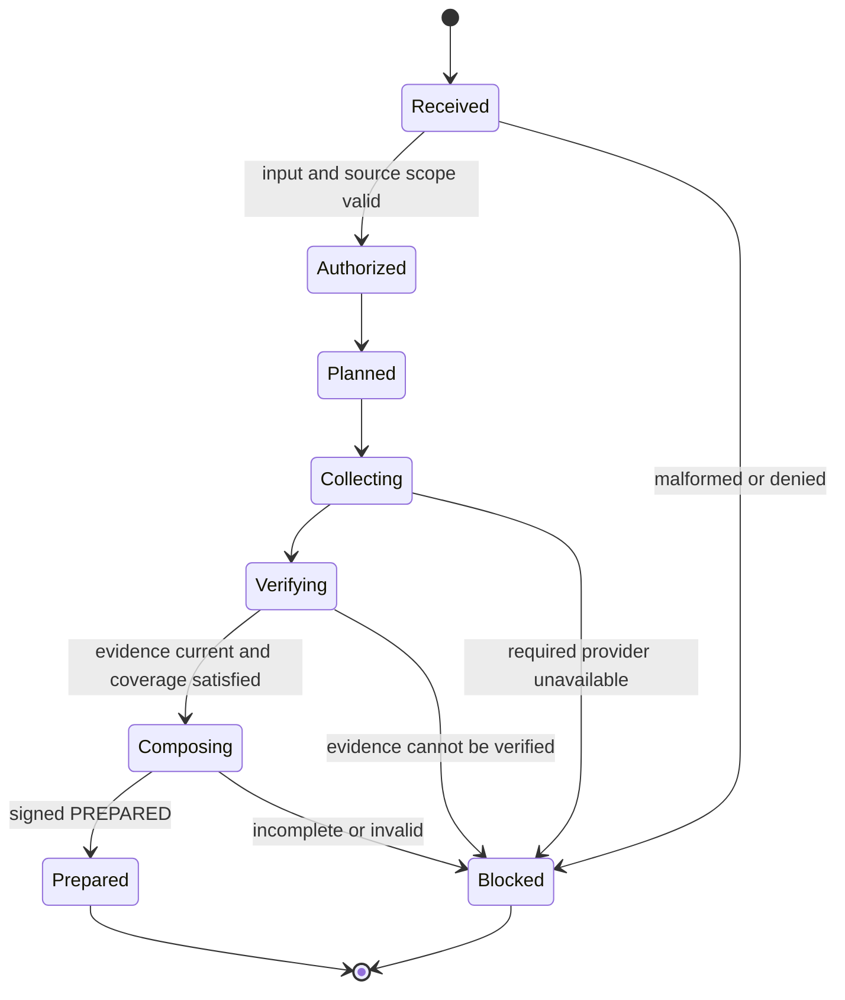
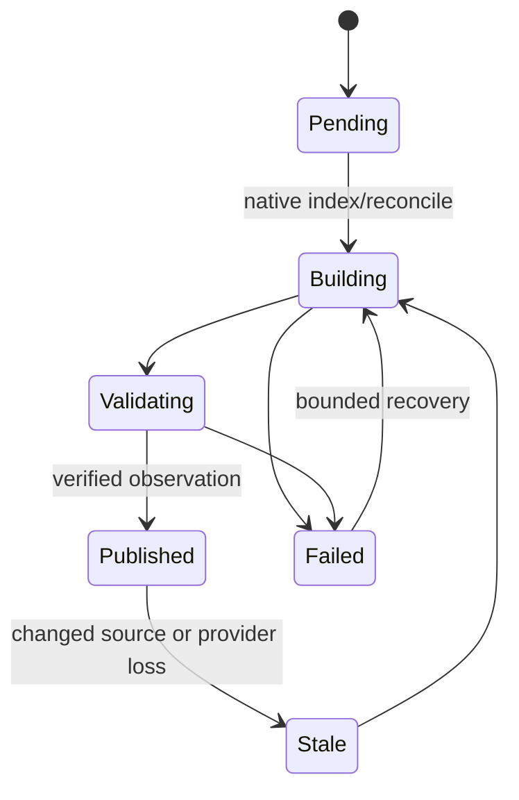
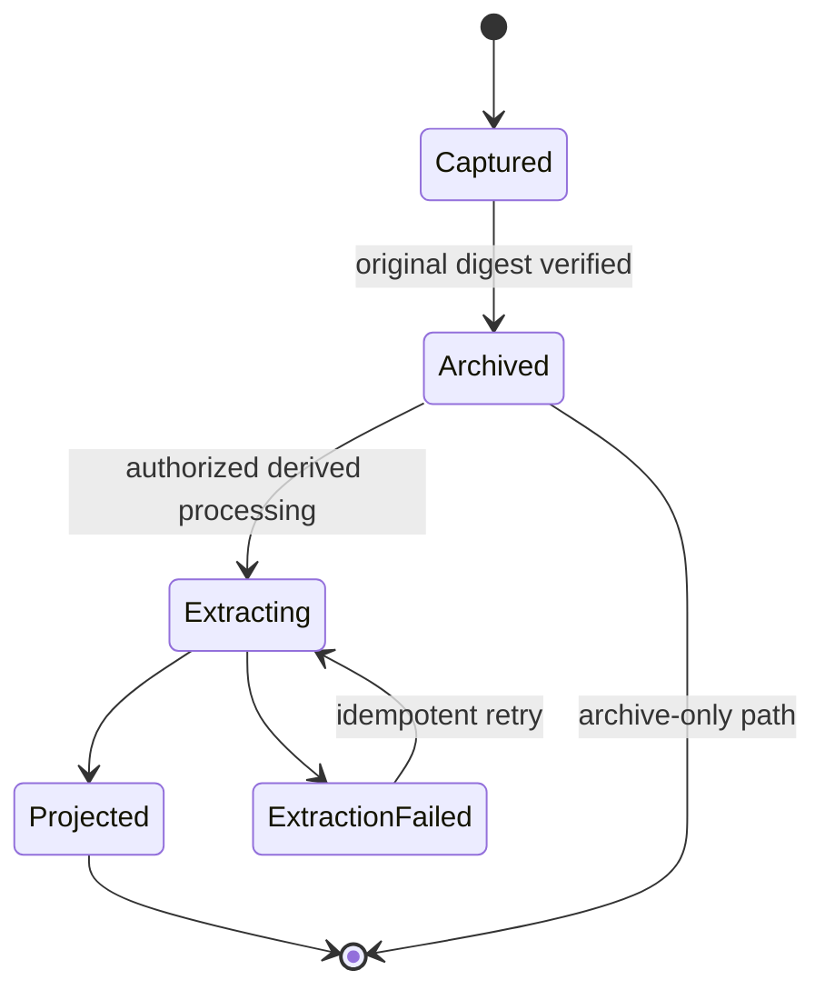
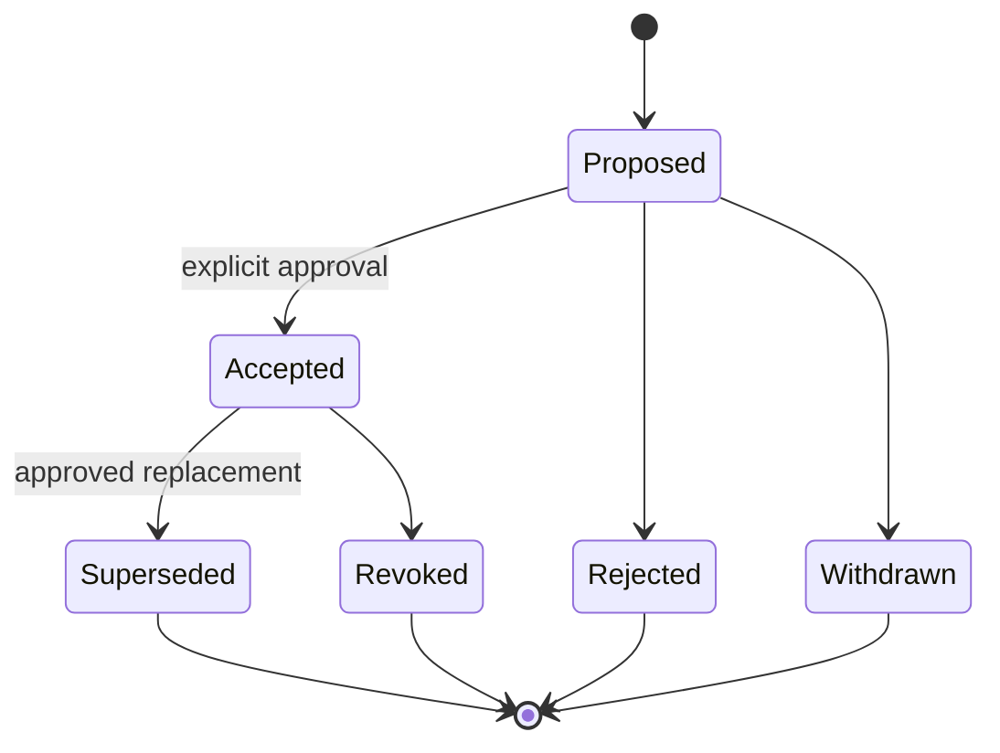
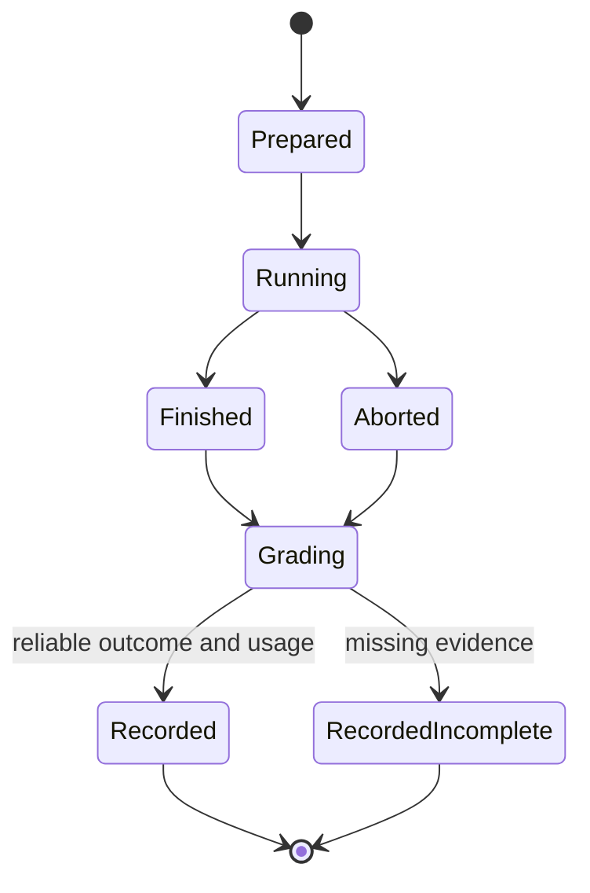

# ACE — State machines and end-to-end workflows

> **Design model, not an implementation inventory.** This document reconciles the original logical design with the native CBM cutover and the single Bifröst boundary. Identifiers, proposed events and logical consistency boundaries do not imply that corresponding classes, tables or public operations exist. The [original record](https://github.com/chris-madsen/Hybrid-RAG/blob/d19b8ac04ce3861ee0b477fd5253c684edb5136f/docs/architecture/04-fsm-workflows.md) remains in Git history. Current implementation and acceptance are described in [current runtime architecture](../operations/current-architecture.md), the accepted ADRs and applicable OpenSpec.

**Status:** logical workflow models. Use explicit state transitions where ordering protects invariants; do not model ranking or every symbol as a state machine. Labels below are conceptual except where the actual v3 protocol decisions are explicitly named.

## 1. FSM-01: ContextRequest

PREPARED ends the projection operation, not the model request. Bifröst must separately authorize each physical attempt using the bound receipt and actual body/route. An authorization denial stops the send; retries require independent authorization. A permitted send is not a provider acknowledgement, and a provider acknowledgement is not proof of agent task success.

Required-source failure must not yield false complete evidence or a silent passthrough. Internal evidence may be partial, but the current native projection may block. Resource deadlines protect finite execution, not arbitrary truncation of exact originals.

## 2. FSM-02: Code index observation

These describe ACE's logical publication validity, not CBM's private database states. CBM owns the native index/cache. An old observation does not become fresh because the process restarted, an index exists or a candidate scored highly. Reconcile source and verify exact bytes; external daemon/cache topology requires separate evidence.

## 3. FSM-03: Session and knowledge extraction

The archive is independently implemented; derived Graphiti recall through the gateway is a target. Extraction failure cannot corrupt the raw archive. Authorized deletion/tombstone policy governs access and reference-safe cleanup.

## 4. FSM-04: DecisionRecord (logical temporal model)

Conflicted is an evidence-quality attribute orthogonal to decision status. Acceptance requires authoritative approval/provenance, not an extraction summary. Supersession preserves the prior decision and rationale.

## 5. FSM-05: BenchmarkRun

Include aborted runs in success/cost accounting. Mark missing usage unknown, not zero. Freeze suite identities before evaluation and give reruns distinct run identities.

## 6. End-to-end workflow specifications

### UC-01: Locate a retry implementation and fix its loop

1. Hermes sends native Responses to the configured Bifröst subscription route; the post-auth connector calls local context RPC v3.
2. ACE verifies request/source scope, discovers candidates through native CBM and rereads exact current source. No independent LSP assertion follows from graph hints.
3. ACE checks required coverage and prepares additive context with a signed receipt or returns BLOCK.
4. Bifröst independently authorizes the actual physical attempt and sends only if allowed under the approved scope. The model/agent retains its existing editing and testing tools.
5. Subsequent requests reconcile changed source observations. A stale hit must not be returned as current.

This is the supported source-level design; external provider and multi-turn agent acceptance remain separate.

### UC-03: Recall an alternative discussed two weeks earlier (target)

An authorized temporal retrieval operation would retrieve Graphiti candidates, resolve original archive episode references, and distinguish the decision status at the requested time from the current status. Conflicting evidence stays explicit; restricted originals cannot be substituted with fabricated quotations. The active native projection has no memory-search tool exposed to the model and no configured Graphiti provider.

### UC-04: Source changes during retrieval

If the observed source digest D1 no longer matches the current file D2, invalidate the old evidence and re-observe/reverify under a bounded operation. If the race cannot be resolved, return typed failure or incomplete evidence as applicable. Never mark D1 current merely because the index still returns it.

### UC-09: Vertex unavailable or cloud transfer forbidden

For a future combined required-source plan, a technical Vertex failure must be represented as missing coverage; code evidence alone cannot satisfy a required document obligation. A policy denial prevents the external request, not just its result; no unauthorized alternate service. The current code-only projection does not require Vertex.

### UC-long: Agent generates a large patch

The agent owns patch creation, tool output and its own compaction. ACE preserves original native input and exact authorized source access; compact retrieval does not silently alter a patch. Verify exact original bytes or reassembled ranges with digest comparison. Do not claim a public expansion endpoint that is absent from the current contract.

## 7. Avoid unnecessary state machines

Ranking, native search, candidate scoring and graph traversal are operations, not lifecycle states. Use typed decisions, bounded transitions, property tests and explicit provider failures. Adopt a workflow library only for a demonstrated need. See [current architecture](../operations/current-architecture.md) and [fitness contracts](07-architecture-fitness-contracts.md).
