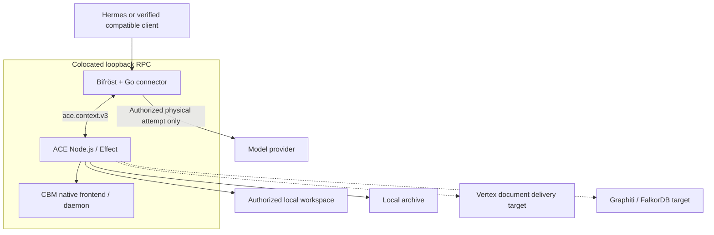

# Bifröst single-gateway contracts and ACE context RPC deployment

> **Design model, not an implementation inventory.** This document reconciles the original logical design with the native CBM cutover and the single Bifröst boundary. Identifiers, proposed events and logical consistency boundaries do not imply that corresponding classes, tables or public operations exist. The [original record](https://github.com/chris-madsen/Hybrid-RAG/blob/d19b8ac04ce3861ee0b477fd5253c684edb5136f/docs/architecture/05-contracts-and-deployment.md) remains in Git history. Current implementation and acceptance are described in [current runtime architecture](../operations/current-architecture.md), the accepted ADRs and applicable OpenSpec.

The active protocol is the TypeSpec-defined internal ace.context.v3 interface; older internal versions and provider-specific designs are historical. The agent-facing route belongs to Bifröst, not ACE. The [current runtime](../operations/current-architecture.md) and [readiness matrix](../operations/ace-configuration-and-readiness-matrix.md) describe actual configuration and limitations.

## 1. Boundary invariants

1. Bifröst is the sole supported agent-facing model endpoint. Native Responses is the active protocol; no second model request, model-invoked ACE retrieval tools or alternative provider protocol is implied.
2. The coding agent owns source changes, Git operations and tests. ACE reads authorized project sources and maintains its own state/artifacts.
3. Domain types do not import provider DTOs. Exact source paths/ranges are contained within authorized workspace scope.
4. External transfers require explicit data-class/destination permission; a prepared request is not a send authorization.
5. Original source access is lossless where authorized. Relevance-driven excerpts are not replacements for originals.
6. Evidence method, provenance, uncertainty and required coverage remain explicit. A derived summary is not an original.
7. No unsupported capability or missing evidence becomes a success by default.

## 2. Gateway projection surface — sole agent-facing delivery

| Boundary | Input | Result / control |
|---|---|---|
| Bifröst native subscription ingress | Native Responses, Hermes-owned subscription bearer | Bifröst routes to the exact native subscription target; no stored API-key fallback. |
| GET /internal/ace-context/v3/health | Authenticated local request | Liveness, adapter readiness and certification status; not a live-provider certificate. |
| GET /internal/ace-context/v3/capabilities | Authenticated local request | Supported capability and certification state. |
| POST /internal/ace-context/v3/project | Versioned request/session/workspace/provider/model, exact body bytes and digest, query, attestation, deadline | PREPARED with additive projected body and signed receipt, or BLOCK. |
| POST /internal/ace-context/v3/authorize-attempt | Actual attempt identity, route, final body/digest, prepared-body binding, receipt and deadline | Bound allow/deny under current policy; single-use attempt, no fallback on denial. |

The post-auth Go connector uses the local project operation and the terminal Bifröst guard obtains the attempt decision. The guard checks final native semantics and exact attempt identity before physical dispatch. The provider validates the subscription bearer; ACE does not add an OAuth verifier. Ordinary generation remains subject to certification; the owner permits a narrowly bounded disposable C03–C05 probe under exact data/destination policy. That permission is not production approval.

See [TypeSpec source](../../typespec/context-v3.tsp), [projection service](../../src/application/responses-projection-service.ts), [attempt authorization](../../src/application/gateway-attempt-authorization-service.ts) and [subscription runbook](../operations/gateway-subscription-oauth.md).

## 3. Versioned ContextBundle (logical internal contract)

A bundle identifies the request/workspace and selected evidence, source method, source reference, digest/version, range/encoding, certainty, freshness, required coverage and limitations. It may contain compact excerpts; authorized originals remain independently accessible. Complete-within-scope, partial and unknown are distinct. Do not claim a symbol or range not supported by the actual provider. The original EvidenceV1/ContextBundleV1 sketch is historical, not a wire schema. Use the actual domain model and generated v3 contract rather than inventing fields or agent-callable expansion commands.

## 4. Domain ports (logical boundary)

| Responsibility | Actual ownership / constraint |
|---|---|
| Workspace observation and verified read | ACE source containment, manifest and exact bytes |
| Code discovery / structural analysis | Native CBM index, graph, outlines, semantic/BM25; no independent vector stack |
| Language semantics | Retained separate LSP contracts/adapters; not requested by current code-only projection |
| Documentation search | Authorized Vertex corpus adapter; combined delivery target |
| Temporal memory | Immutable archive and future Graphiti/FalkorDB projection |
| Policy | Explicit source and outbound permission, receipt/attempt verification |
| Original artifacts | Exact authorized reads, provenance and lifecycle |
| Evaluation | Frozen task identity, independent grading and usage/attempt evidence |

The actual application port interfaces are in [ports.ts](../../src/application/ports.ts). Logical responsibility names are not additional SDK methods. Functional DDD and Effect own internal behavior; TypeSpec owns versioned wire DTOs.

## 5. Error taxonomy and failure policy

These are semantic categories, not an invented list of wire enum values. Use the reason codes emitted by the generated contract and runtime.

| Category | Required behavior |
|---|---|
| Authorization, secret or data-policy denial | Fail closed; safe audit; no alternate external route |
| Required provider unavailable or deadline expired | Typed failure/not ready; no false complete projection |
| Source digest mismatch or concurrent mutation | Re-observe within bounds or reject stale evidence |
| Unresolved semantic claim | Report unavailable/uncertain; no fabricated definition |
| Derived extraction failure | Preserve original archive; reconcile according to approved policy |
| Missing usage | Unknown telemetry, not zero |
| Large source | Preserve exact authorized access; no silent truncation |

Audit records contain safe identities, outcomes and reason codes rather than raw prompts, source snippets or credentials. Full observability is deferred by ADR-010.

## 6. Synchronous and asynchronous boundaries

Within the authorized projection: validate identity/scope, plan required retrieval, query native provider, reread and verify source, assemble and sign the projection. At the final transport: authorize the actual attempt, including retry identity and current policy. Neither stage establishes provider response success. Index reconciliation, archive import, derived temporal extraction and evaluation aggregation have independent lifecycle requirements. Do not assume a distributed transaction across Git, CBM, Graphiti and Vertex.

## 7. Deployment topology and constraints

Current supported code retrieval uses a registered ACE-local workspace, pinned native CBM and a dedicated verified cache/service identity. The runtime rejects the retired remote helper; remote host access and shared daemon/cache topology require research and acceptance. A local Docker image and existing Kubernetes dependency manifests do not prove a production k3s deployment. Do not choose an unapproved host mount or split the monolith by domain boundaries. Harbor uses its separately pinned task environment.

## 8. Data classification and external services

| Data | Current policy boundary |
|---|---|
| Private source / uncommitted changes | Local indexing; model-bound disclosure separately requires exact provider/model/destination and data-class authorization. No Vertex source-upload permission is implied. |
| Project documents | Explicit Vertex enablement, cloud-document opt-in and authorized corpus; no implicit authorization for other classes. |
| Private conversation | Original archive under approved retention/access; external model-bound disclosure and extraction are separately controlled. |
| Secrets | Denied external transmission; safe metadata only in diagnostics. |
| Benchmark fixtures | Explicit authorized scope; frozen identities and retained evidence. |

Current native Responses projection requires code evidence and rejects non-code evidence. Do not present authorized Vertex retrieval or archive tooling as already combined with code in the outbound request.

## 9. Versioning and migrations

Deploy matching generated v3 service/connector artifacts atomically. Bind source, provider versions and build provenance. Native CBM owns its index/cache format; ACE owns observation validity. Archive extraction versions cannot rewrite raw originals. Freeze task/model/tool/environment versions for benchmarks. Historical contracts remain in Git without compatibility aliases.

## 10. Technology boundary

TypeScript and Effect implement the functional modular monolith; Go is the Bifröst connector boundary. The native CBM executable owns code indexing and retrieval. Python remains for independent memory/HTTP/evaluation tooling. Language choice does not define a deployment boundary. Additional implementations require demonstrated need and the applicable owner/ADR process.

## 11. Open questions and acceptance

Native retrieval quality, scale, lifecycle, daemon/cache and remote topology remain #363. Independent LSP remains #364. Authorized combined document/temporal delivery, archive recovery and deployment have separate evidence requirements. Native physical provider send, stream/cancellation, real agent and paired economics are governed by [OpenSpec 013](../../openspec/changes/013-gateway-g11-production-acceptance/tasks.md) and #171. Do not treat a local projection, mock, provider adapter or green build as production acceptance.

## Implementation correction — executable composition and proof

Require the actual selected provider, observed invocation, verified exact source and required coverage; preserve typed failure, request/attempt identity, cancellation, worktree integrity and provider policy. Measure appropriate real provider and agent outcomes, not interface existence. [Fitness contracts](07-architecture-fitness-contracts.md) and applicable OpenSpec determine acceptance.

## 12. Hybrid context contract and evolution

ADR-014 describes the hybrid context objective; the native CBM cutover supersedes separate vector and parser implementations. Working-context hints and already-known evidence identities must be explicitly supported by the applicable contract; do not invent host transcript attestation or implicit editor state. Exact-source access and agent independence remain design principles. Graphiti and Vertex delivery require evidence for their actual integrated route. See [current architecture](../operations/current-architecture.md).
