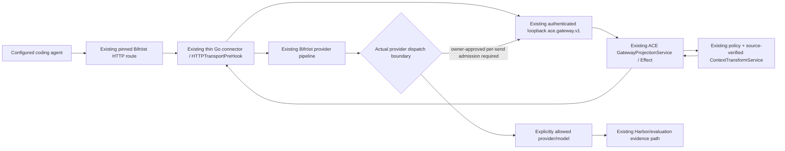

# Design — G11 production evidence and safe enablement

> **Status:** PROVISIONAL / NEEDS_OWNER_DECISION. This is a design candidate for owner G02 review, not an accepted architecture or implementation authorization. G11 requirements in this existing OpenSpec change remain authoritative.

## Identity and source inputs

- Repository: `chris-madsen/Mult-agent-AI-Orchestration`.
- Architecture-stage input: PR #260 at `e3533e75b1abfb31f0193390d3d320e0012eab52`, stacked on PR #259.
- Current product-source baseline: `origin/main@e99e81a1a758fbf6be96599dc09c4440fd51f833`; PR #259 changes SDLC files, not the Gateway product source traced here. Relevant product files are unchanged in PR #259's diff.
- Current upstream implementation inspected: `maximhq/bifrost@fe7634a6c828927d05ffdd57c62be0aaab04193f`.
- Research artifact: `docs/reviews/2026-11-16-g11-current-source-research.md`.
- Acceptance authority: `openspec/changes/013-gateway-g11-production-acceptance/`; G02 remains `REVIEW_REQUIRED`.
- External permission: no real provider/model/agent, paid traffic, or private-source egress is authorized by this design draft.

## 1. Goal, scope and non-goals

Prepare the smallest architecture delta that could produce route-specific G11 evidence while preserving the accepted Bifröst-only agent path, TypeScript + Effect ACE core, current OpenSpec ownership, existing TypeSpec Gateway v1 contract, and owner-controlled release decisions.

This design does **not** implement product code, change G11 requirements, add an OpenSpec change, alter `ace.gateway.v1`, choose a production provider/model, authorize egress, approve G02, build a second proxy, add an event bus/FSM framework, or promote a capability to production.

## 2. AS-IS: observed architecture at the source baseline

| Owner / module | Observed responsibility and wiring | Evidence and limits |
|---|---|---|
| Agent Access (supporting adapter, not a Core bounded context) | Bifröst HTTP transport → thin Go connector → authenticated loopback `ace.gateway.v1` projection API. The connector binds session correlation, physical request ID, request body digest, explicit provider/model and the first projected body. | `integrations/bifrost/ace-connector/plugin/main.go:72-132,213-275`; `connector.go:223-346,352-416`. No live deployed plugin order was observed. |
| ACE Gateway application | Existing `GatewayProjectionService` validates the v1 request, checks policy/provider allowlist and likely secrets before `ContextTransformService`, and returns `APPLY` or `BLOCK` for Gateway mode. | `src/application/gateway-projection-service.ts:95-134,163-228`; `src/bin/ace-runtime.ts:1090-1137`. No request-level persistent attempt ledger is composed here. |
| ACE Gateway domain | Existing readonly request/receipt/decision types and validation; `receiptFor` currently emits `attemptIndex: 0`. | `src/domain/gateway-projection.ts:24-64,127-186`; `src/application/gateway-projection-service.ts:30-43`. TypeSpec is the source of the current public/versioned Gateway wire. |
| Trust & Data Policy | Existing policy ADT and pure `authorizeOutbound`; `authorizeAndAudit` orchestrates safe audit I/O through Effect ports. | `src/domain/policy.ts:5-35,78-135`; `src/application/policy-service.ts:12-35`. Gateway projection currently authorizes the selected provider before retrieval, then checks transformed content. |
| Workspace/context retrieval | Existing `ContextTransformService` validates workspace/request identity, calls the existing context provider and assembler, and returns selected evidence with explicit limitations and source identity. | `src/application/context-transform-service.ts:10-68,115-211`. `ace-runtime.ts` composes the existing providers; this design does not relocate them. |
| Bifröst attempt processing | Pinned Bifröst runs `PreLLMHook` before dispatch and on each outer `tryRequest` (primary/fallback). Separately, the provider worker runs `executeRequestWithRetries` beneath that hook and can invoke the provider callback more than once for one `tryRequest`. | `core/schemas/plugin.go:241-263,406-419`; `core/bifrost.go:5910-5912,5945-5977,6287,7045-7129,7460-7461,8219-8220,8352-8380`. The effective deployed `NetworkConfig` and physical network sends were not observed. |
| Streaming / body capture | Bifröst has transport stream-chunk hooks; its HTTP request serializer skips body copying above its configured large-body threshold or for unknown/chunked content length. ACE currently parses the request body and returns 400 when the expected JSON is unavailable. | Bifröst `core/schemas/plugin.go:359-390`, `transports/bifrost-http/handlers/middlewares.go:1089-1144`; ACE `plugin/main.go:147-175,232-244`. No streaming or threshold-specific integration run was executed. |
| Public wire | TypeSpec owns the existing v1 ProjectionRequest/Receipt/Decision; request has `requestId` and `attemptGroupId`, while `attemptIndex` is currently a receipt field. No G11 per-attempt request field is proposed as accepted. | `typespec/main.tsp:42-108,150-169`; generated adapter types under `src/generated/ace-gateway/`. Any required wire expansion must remain TypeSpec-first and owner-reviewed. |
| Evaluation | Existing `EvaluationSuite`, `BenchmarkRun`, usage ledger, quality outcomes and Harbor byte-binding modules are present; deterministic tests retain failures and unknown usage. | `src/domain/evaluation.ts:44-72,163-275,277-520,554-641`; `src/application/harbor-byte-binding.ts:44-75,92-109,164-207`; `test/evaluation.contracts.test.ts:92-237`. No current G11 real-agent paired run was observed. |

The repository's strategic DDD document explicitly labels its bounded-context map and module boundaries as proposed design rather than accepted decisions (`docs/docs/architecture/01-strategic-ddd.md:5,52-70,72-104`). This proposal therefore uses those names as an ownership vocabulary, not as evidence of separately deployed services or fully enforced semantic boundaries.

## 3. The attempt-boundary finding that constrains TO-BE

The pinned Bifröst source has two distinct retry layers:

1. **Outer provider fallback:** `handleRequest` calls `tryRequest` for the primary and calls it again for each configured fallback (`core/bifrost.go:5910-5912,5945-5977`). Each `tryRequest` runs `RunLLMPreHooks` before its provider work (`:6287`), so ACE can observe these outer calls and currently short-circuits configured fallbacks.
2. **Inner same-provider retry:** the request worker calls `executeRequestWithRetries`, which loops over `NetworkConfig.MaxRetries + extraAttempts` (`:7045-7129`) and invokes its provider callback again on each dispatched iteration (`:7460-7461,8352-8380`). That loop is below `RunLLMPreHooks`; it does not call the ACE plugin again. The pinned code notes a default `MaxRetries` of zero but also grants extra attempts for certain permanent per-key errors and encrypted-reasoning stripping (`:7114-7120,7651-7663,7674-7688`).

**Implication:** the current ACE `PreLLMHook` receipt/one-use marker cannot by itself establish fresh authorization for each Bifröst inner retry callback. Whether a callback produces a physical external send, how effective retry settings are configured, and which extra-attempt paths are reachable for the selected route are unobserved. G11-009 and the accepted ADR-017 actual-attempt egress rule therefore remain `BLOCKED` for implementation/promotion until the owner reviews a testable dispatch boundary. `AllowFallbacks=false` governs the outer fallback decision; it does not, by itself, disable the inner `executeRequestWithRetries` loop.

The same retry loop may alter request semantics (for example, strip encrypted reasoning before a granted retry). That changes the body after the initial Gateway receipt unless the actual send is reauthorized. This is a source-level risk, not a claim that a specific provider request did so in production. Effective Bifröst configuration was not inspected and no retry-triggered mock-upstream fixture was run.

### Alternatives for owner G02 review

| ID | Alternative | Benefit | Limitation / decision boundary |
|---|---|---|---|
| DEC-G11-01 | Keep all ACE provider routes uncertified where Bifröst's inner retry cannot be observed/disabled. | Preserves fail-closed claims without a new transport. | Does not deliver G11 retry acceptance; the owner must decide whether the current route may be used outside production certification. |
| DEC-G11-02 | Use a supported Bifröst-native per-dispatch hook/extension that runs inside every `executeRequestWithRetries` callback and binds the exact normalized body/destination before each provider send. | Aligns authorization with Bifröst's actual retry boundary while retaining the selected Gateway. | The pinned plugin API observed here exposes HTTP transport, request, per-outer-attempt and response hooks, but no confirmed callback inside the inner retry loop. Any upstream extension must be inspected, pinned and owner-approved; do not emulate it with a second proxy. |
| DEC-G11-03 | Prove that all inner retry/extra-attempt paths can be disabled for the certified route and enforce that configuration at runtime. | Could avoid authorizing an unobserved second send if the platform guarantees single dispatch. | `MaxRetries=0` alone is not yet shown to disable all `extraAttempts`; configuration-only claims need source and negative-wire tests. |

**Recommendation for review:** keep `providerWire=not_certified` and make no claim that internal retries are blocked until the owner selects a feasible per-dispatch boundary or confirms a fully enforced single-dispatch route. No solution above is accepted by this document; this is a G02 owner decision.

## 4. Minimal TO-BE architecture proposal



The box `Actual provider dispatch boundary` is intentionally unresolved: the current pinned ACE hook is above Bifröst's inner retry loop. The diagram does not claim that a new loopback call or API route exists. If the exact pinned Bifröst build has no supported extension at this point, the affected retry route remains unsupported until an owner decision; do not add a reverse proxy or move ACE business logic into Go.

### Ownership and context-map relationship

| Logical owner | Existing responsibility retained | G11 responsibility proposed |
|---|---|---|
| Bifröst + thin Go connector (Agent Access supporting adapter) | Configured endpoint, credentials, HTTP parsing, provider selection/fallback machinery, request-local context propagation | Evidence of actual route/plugin order and each provider dispatch; fail closed when the exact attempt cannot be bound. The Go adapter remains thin. |
| Existing ACE Gateway Projection application/domain | v1 request validation, provider allowlist/data policy, source retrieval/projection, typed `APPLY`/`BLOCK` receipt | Candidate pure attempt-authorization transition and safe audit, only after G02 selects the actual send seam and any public-contract change. |
| Trust & Data Policy | `ProjectDataPolicy`, `authorizeOutbound`, `authorizeAndAudit` | Re-evaluate provider/model, data class, secrets and current policy for every *actual* dispatch, not merely once per ingress. |
| Workspace Truth / Code Discovery / Semantic Intelligence | Existing context provider, source verification, retrieval/AST/LSP evidence | No new retrieval owner; selected evidence remains source-verified and policy-authorized. |
| Evaluation (existing domain/adapters) + Harbor runner | Frozen suites, byte binding, usage/quality accounting, run evidence | Bind every ACE claim to a correlated actual Gateway attempt/final-send; retain failed/unknown trials. The **current G11 Hermes two-arm feedback owner** is `src/domain/feedback-loop-experiment.ts`, `src/adapters/harbor-feedback-trial-evidence.ts`, `scripts/collect-feedback-loop.ts`, `scripts/feedback-loop-preflight.ts`, and `scripts/render-feedback-summary.ts`. Historical `harbor-four-arm` Codex paths are not the G11 execution owner. No new runner. |
| ACE owner | G02, external data/provider permission, promotion | Select material architecture alternatives, provider/model/agent, budget, and final route certification. |

No new bounded context, remote service, store, event bus or deployment is currently justified. A new in-process port or aggregate is not automatic; add one only if the owner-approved dispatch seam establishes a real variation and consistency boundary.

## 5. Event Storming (design proposal; not event sourcing)

**Actors:** coding agent; Bifröst transport and provider worker; ACE Gateway Projection; project data-policy owner; external LLM provider; Harbor evaluator; ACE owner.

**Commands:** `CaptureGatewayIngress`, `ProjectAuthorizedRequest`, `AuthorizeProviderDispatch`, `DispatchProviderRequest`, `RecordFinalSendEvidence`, `CancelStream`, `RecordAttemptOutcome`, `GradeBenchmarkRun`, `ApproveRouteCertification`.

**Meaningful facts/events:** `GatewayRequestBound`, `ProjectionApplied`, `AttemptAuthorized`, `AttemptDenied`, `FinalSendObserved`, `ProviderResponded`, `ProviderAttemptFailed`, `StreamPartiallyDelivered`, `RunQualityRecorded`, `BenchmarkMeasurementUnknown`, `RouteCertificationInvalidated`.

These are proposed domain facts for acceptance/evidence. They do **not** authorize a durable event bus, event sourcing or a new ledger. Existing safe audit/evidence ports remain the first integration point; durability and at-most-once state are separate owner decisions if a demonstrated invariant requires them.

**Consistency boundaries and hot spots:**
- A Gateway physical request is not automatically the same unit as every Bifröst provider callback; the retry loop is the primary hot spot.
- A retry/fallback decision must bind a fresh provider/model/body digest, data class, policy version and attempt identity at the selected dispatch seam.
- A stream may have irreversible chunks before cancellation/error; result state must be `partial`/`cancelled` rather than a false rollback or success.
- Source/policy changes between projection and a later attempt are relevant; the policy must be evaluated at send time.
- A final provider response, token counter or mock-upstream capture cannot be inferred from an ACE receipt alone.
- A Harbor holdout is immutable across tuning; incomplete usage remains `UNKNOWN`, not zero.

## 6. Functional domain model and Effect boundaries

### Existing model

The current domain owns readonly `GatewayProjectionRequest`, `GatewayProjectionReceipt` and `GatewayProjectionDecision` ADTs (`src/domain/gateway-projection.ts:24-64`) and a pure `validateGatewayProjectionRequest` function (`:127-186`). `authorizeOutbound` in `src/domain/policy.ts:78-135` returns a typed `AccessDecision`. The application service composes policy, audit and the existing context transform in Effect (`src/application/gateway-projection-service.ts:95-134,163-228`). Domain code does not own Bifröst DTOs or provider network I/O.

### Candidate attempt ADT (proposed, not accepted)

If G02 accepts an observable per-dispatch seam, extend the existing Gateway domain owner rather than create a new service:

```text
AttemptBinding = Readonly<{
  requestGroupId, attemptId, sessionId, provider, model,
  finalBodyDigest, dataClass, policyVersion, deadline
}>

AttemptState =
  | Planned { binding: AttemptBinding }
  | Authorized { binding: AttemptBinding, receiptId, expiresAt, consumed: false }
  | Dispatched { binding: AttemptBinding, receiptId, finalSendDigest }
  | Denied { binding: AttemptBinding, reasonCode }
  | Partial { binding: AttemptBinding, receiptId?, sentBytesKnown, failureClass }

decideAttempt(state, command, currentPolicy) ->
  Result<{ nextState, facts }, DomainError>
```

Candidate rules: authorization may follow `Planned` only after destination/data-policy checks; dispatch consumes exactly one attempt decision; retry creates a new planned attempt; no attempt may dispatch from an expired, denied, mismatched or already-consumed authorization. The wire identity (request ID, group ID, ordinal/nonce) and any state persistence mechanism remain undecided until G02 reviews the inner Bifröst retry seam. Do not add shared mutable flags or a generic FSM framework.

**Binding and one-use safety:** the example ADT deliberately retains the *same immutable* `AttemptBinding` across all transitions: authorization must never erase provider/model/body/policy/session identity before consumption. The `Authorized → Dispatched` transition must compare the actual final normalized body/destination against that binding and atomically consume the receipt at the real provider-send boundary; a pure `decideAttempt` function alone cannot enforce cross-process at-most-once. If concurrent/restarted requests are in scope, obtain G02 approval for an actual atomic transaction/CAS/fencing owner or fail closed. No state store, token format or Bifröst hook is silently selected here. A safety-preserving **single-dispatch route** is a different (possibly narrower) supported capability than a *retry-enabled* route: blocking retries must never count as positive G11-009 retry evidence. These are contract constraints pending verified runtime seam and G02.

**C02 pre-egress gate:** one inbound request is *not* proof of one physical provider send. Before any authorized non-stream real-provider trial, prove using the exact pinned Bifröst runtime/config and synthetic mock-upstream that **all** inner `MaxRetries` and `extraAttempts` paths are either disabled/enforced no-send or separately authorized at the actual callback. If the operator cannot establish the safe one-send boundary, C02 remains `BLOCKED` even with G02/consent. This does not require implementing all C04 retry support first, but it does require a strict negative no-second-send test and immutable runtime/config provenance.

**Effect shell:** existing `GatewayProjectionService` owns orchestration, ports, audit, cancellation and errors. The Go connector remains the serialization/transport adapter. The selected provider credentials stay in Bifröst. Policy/audit failure, missing body identity, unknown destination, deadline, secrets or stale receipt must yield an explicit typed denial/unavailable result before any unapproved send.

## 7. TypeSpec and versioned contracts

The current `typespec/main.tsp` defines `ProjectionRequest` with `requestId`, `attemptGroupId`, provider/model, body digest and attestation; `ProjectionReceipt` carries `attemptIndex` (`typespec/main.tsp:42-108`). The current request has no separate physical-attempt ordinal field. The HTTP contract explicitly retains provider wire `not_certified` and a 501 delivery record operation (`:110-169`).

No wire change is included in this design stage. If the selected per-send protocol cannot be represented unambiguously by the existing v1 request/receipt, the owner must review a TypeSpec-first additive/versioned contract and its compatibility/negative tests before implementation. Do not add a handwritten Go/TypeScript DTO or use a generated schema as a substitute for runtime policy.

## 8. Bertrand Meyer contracts and evidence owners

| Operation | Require / precondition | Ensure / postcondition | Invariant + frame | Exceptional outcome |
|---|---|---|---|---|
| Gateway projection | Valid v1 request; registered workspace; exact explicit provider/model; valid digest; policy and deadline current. | `APPLY` contains only the permitted additive message and receipt bound to request/body; otherwise explicit `BLOCK`. | Existing model/tools/stream/unknown fields and original messages are unchanged; user worktree and originals are untouched. | Malformed, unauthorized, secret, stale, missing required retrieval or audit failure never becomes unchanged successful dispatch. |
| Actual provider dispatch / retry | A selected Bifröst physical-send boundary is observed; exact current body/destination is known; a fresh attempt decision exists. | Each permitted send has unique attempt identity, receipt and final-send evidence; denied attempts have zero provider calls. | No reuse of an ingress receipt for an unobserved inner retry; no provider/model drift; no silent fallback. | If the boundary is unavailable or the receipt cannot be checked, keep the route uncertified and stop before egress; partial bytes cannot be rolled back. |
| Streaming / cancellation | Exact stream variant is route-qualified; request, deadline and provider identity are bound. | Ordered chunks and terminal state are recorded; cancellation/timeout/midstream failure yields complete, cancelled or partial truthfully. | Never coerce stream to non-stream, discard unknown fields, log private chunk content or claim retraction of sent bytes. | Unsupported shape denies before dispatch; after any sent bytes, expose partial outcome and unknown usage honestly. |
| Harbor evaluation | Frozen task/revision; matched agent/provider/model/reasoning/permissions; approved data; bound Gateway receipts; independent quality oracle. | Every arm/run is retained with exact usage or `UNKNOWN`, cost, latency, quality and provenance. | Holdout is immutable; cached/reasoning subsets are not double-counted; baseline keeps native capabilities; failures stay in denominator. | Missing receipt, failed quality, timeout or missing usage prevents causal savings claim and leaves the run incomplete/blocked. |

These are proposed contracts for G02 review. Unit/contract tests can prove only deterministic state/policy behavior; synthetic upstream captures prove mock-wire behavior; real provider wire, real-agent E2E, Harbor economics and owner approval remain separate evidence stages.

## G02 crosswalk

Every row is `PROPOSED / REVIEW_REQUIRED`; no row is self-approved by this document. “Phase responsibility” is a planning hint only; the Plan stage chooses actual slice count/IDs after architecture review.

| AC | Owner | Decision | Interface/state | Phase | Deterministic oracle | Provider/agent oracle |
|---|---|---|---|---|---|---|
| G11-001 | Bifröst + ACE Gateway owners; G02 reviewer | Preserve 010 and v1; final-send proof still required | Exact authorized Chat projection → final send | Terminal wire | Synthetic upstream compares model, route, tools, stream, opaque fields, original messages and one ACE insertion/digests | Authorized real provider response with final-send correlation |
| G11-002 | Bifröst deployment owner; G02 reviewer | Deployment-specific plugin order must be observed; withhold certification until then | Loaded hook order and post-guard mutation | Terminal wire | Later-mutator/order-negative fixture rejects certification | Live loaded plugin order and actual terminal bytes |
| G11-003 | ACE owner / operator | No provider or budget selected; external permission required | Explicit provider/model + allowed test data | Non-stream provider trial | Evidence classifier rejects mock receipt as real | Authorized real provider response and redacted final-send record |
| G11-004 | ACE Gateway owner; G02 reviewer | Capability is route × provider/model × source/config; stale pins invalidate | Per-route status remains `not_certified` until evidence | Certification matrix | Pin/config drift fixture invalidates evidence | Fresh exact route/provider runtime proof |
| G11-005 | Bifröst + ACE owners | Stream is independent capability; not inferred from JSON rewrite | Exact stream=true variant | Streaming | Chunk order, terminal event and projection fixture | Real authorized provider stream terminal event |
| G11-006 | Bifröst + ACE owners | Unsupported protocol/tool/multimodal shapes receive explicit denial | Route capability | Streaming | Unsupported shape produces explicit zero-send denial | Negative real-wire no-egress proof when separately authorized |
| G11-007 | Bifröst + ACE owners | Cancellation cannot undo sent bytes | Stream/attempt state | Streaming | Deterministic cancellation/deadline barrier | Real disconnect/partial-send receipt |
| G11-008 | Bifröst + ACE owners; Harbor | Missing usage and truncation remain partial measurements | Stream result + usage ledger | Streaming | Truncation/transport-error fixture cannot become complete | Real provider abort/usage trace |
| G11-009 | ACE + Bifröst owners; G02 reviewer | **NEEDS_OWNER_DECISION:** `PreLLMHook` is above the pinned internal retry loop | Per-dispatch attempt identity; current wire has no request-side ordinal | Internal retry authorization | Forced inner retry must obtain a distinct authorization or no second provider callback | Real retry route with unique final-send evidence |
| G11-010 | ACE + Bifröst owners; operator | Destination change requires fresh opt-in/policy; no fallback selected | Provider/model/data-class-bound attempt | Fallback authorization | New-destination policy and no-send matrix | Separately authorized provider/model fallback receipt |
| G11-011 | ACE Gateway owner; Bifröst owner | Replay/race/restart scope follows the selected physical-send design | Single-use receipt and attempt state | Attempt authorization | Deterministic duplicate/stale/mismatch/race fixture | Real no-send proof for reused receipt |
| G11-012 | ACE Gateway owner; G02 reviewer | Uncertain policy or audit remains fail-closed | Typed denial/unavailable attempt result | Attempt authorization | Timeout/NOT_READY/secret/audit-failure fixtures deny | Real provider confirms zero sends on denial |
| G11-013 | Agent + ACE + Bifröst owners; operator | Agent/provider not selected; no external run authorized | Configured agent → Bifröst → ACE → provider | Agent E2E | Task route/config/receipt validator | Nontrivial accepted real-agent task on approved route |
| G11-014 | ACE owner; host-attestor owner | Keep host transcript/compaction explicitly unattested unless independent attestor exists | Attestation assurance level | Agent E2E | Unattested inputs cannot promote exclusive-context claim | Attestor test only if installed and separately approved |
| G11-015 | Agent + Bifröst owners | Hidden continuation/second agent route is unsupported | Provider-managed state / route | Agent E2E | Hidden continuation and bypass fixtures are ineligible/blocked | Real agent-route negative evidence |
| G11-016 | ACE owner / operator | External opt-in, provider allowlist, data policy and quality required | Request authorization + task quality | Agent E2E | Policy/secret/quality-negative fixtures | Explicitly authorized provider plus independent task checks |
| G11-017 | Harbor evaluation owner; ACE owner | Use existing 002/ADR-009 strong matched baseline | Frozen suite + matched run identity | Harbor accounting | Byte/task/settings parity checker | Paired real-agent Harbor run |
| G11-018 | Harbor evaluation owner | Unreported counters remain absent; subsets are counted once | Usage ledger and external cost | Harbor accounting | Unknown/cached/reasoning/cost fixtures | Provider/agent usage manifest |
| G11-019 | Harbor evaluation owner | Failed/aborted/cheap-wrong trials remain in denominator | BenchmarkRun quality state | Harbor accounting | Failed-run retention and quality gate | Repeated matched real trials |
| G11-020 | ACE owner / G02 reviewer | No causal or release claim without attempt receipt, holdout and approval | Evidence-stage status | Holdout / owner review | Attribution gate rejects mock/partial evidence | Frozen holdout and explicit owner release decision |

- **C07 agent ingress gate:** current Hermes Harbor adapter selects `openai-codex` but does not configure a Bifröst endpoint; the current ACE plugin only admits Chat Completions. The selected agent/protocol/endpoint must be proven compatible *before* implementing or running agent E2E. Do not assume OAuth Responses traffic traverses `/v1/chat/completions`; no second delivery route is permitted.

## Decisions

### Material owner decisions and alternatives

| Decision | Feasible alternatives | Proposed disposition | State |
|---|---|---|---|
| Actual-send/retry boundary | Use an existing supported Bifröst per-dispatch hook; owner-review a narrow upstream extension at `executeRequestWithRetries`; or keep affected retry route uncertified/disabled if all attempts cannot be intercepted. | Prefer a native Bifröst seam; never add a second proxy. Verify whether the exact pin has such a seam before implementation. | `NEEDS_OWNER_DECISION` before any retry-enabled G11 implementation. |
| Attempt identity in v1 | Derive unique request identity per callback using existing fields; or propose a TypeSpec-first wire extension if physical attempt ordinal/nonce cannot be bound unambiguously. | Do not modify `ace.gateway.v1` or handwrite DTOs in this stage. | `NEEDS_OWNER_DECISION` after seam analysis. |
| Route support | Certify only exact non-stream Chat route/provider/model/pins; or leave the route blocked where terminal wire cannot be proven. | Keep all other variants unsupported until separate evidence. | Reviewable proposal; no production choice. |
| Host transcript/compaction | Keep current honest `unattested` state; or install and test a separate authenticated host attestor. | Keep unattested state; no exclusive-context or savings claim. | No attestor installation requested. |
| External trials and Harbor | Owner chooses disposable data, agent, provider/model, credentials, budget, repetitions and frozen holdout before any call. | No selection inferred from credentials or current implementation. | `BLOCKED` for real egress/paid runs. |

No new ADR is required unless the owner selects a material change that contradicts accepted ADR-017, ADR-019 or the Gateway-only contract. Any such contradiction must be proposed separately; it is not silently settled here.

## 11. Negative sequences, rollback and frame conditions

1. **Unknown/later mutator:** a synthetic final-send observer sees a changed protected field or unknown plugin order → no certification; actual unsafe route is not sent when enforcement is possible.
2. **Inner retry without fresh authorization:** transient provider failure or Bifröst extra-attempt condition enters `executeRequestWithRetries` → no second attempt may be treated as ACE-authorized unless the selected dispatch seam issues a new receipt; otherwise stop/keep route unsupported.
3. **Fallback destination change:** a new provider/model/data-residency target is evaluated against current policy and source data class; deny means zero sends to the target.
4. **Stream cancellation/partial:** record already-sent chunks; cancel pending work and future attempts; no false rollback or clean terminal success.
5. **Provider outage, malformed receipt or audit error:** typed BLOCK/NOT_READY/partial result; never infer absence or successful empty completion.
6. **Benchmark mismatch/failed run/unknown usage:** retain the trial, fail quality acceptance, keep unavailable measurements unknown and reject causal savings.

Frame conditions: no mutation to user worktrees, original session/archive bytes, protected G11 requirements, frozen holdout fixtures or PR #256/#258; no new agent-facing route; no raw prompt/code/secrets in report, CI output or PR body.

Rollback for any future G11 implementation keeps the current `providerWire=not_certified` / 501 state and disables only the affected capability. It must not silently route around Gateway or upgrade a mock result into real evidence.

## 12. G02 and handoff status

- Architecture stage: `PROVISIONAL / NEEDS_OWNER_DECISION`; this is not `G02 PASS`.
- G11 OpenSpec requirements: unchanged; all 20 acceptance IDs are present.
- Requirements stage: reused from existing change 013 after strict validation; no duplicate Requirements PR.
- Internal retry boundary: **static-confirmed source gap for per-send authorization whenever Bifröst retries inside `executeRequestWithRetries`; actual deployed config/send count remain unknown.** This blocks dependent implementation/promotion until owner review.
- Public wire: TypeSpec v1 remains unchanged in this stage; any attempt-identity extension is pending decision.
- Provider/model/agent/egress/paid Harbor: `NOT_SELECTED / NOT_AUTHORIZED`.
- Live project Skill invocation: `NOT_OBSERVED`; repository Skill text was read/applied manually.
- Next stage may prepare provisional To-tickets with an explicit stop gate around the unresolved physical-send boundary. It must not convert this design into implementation approval.
